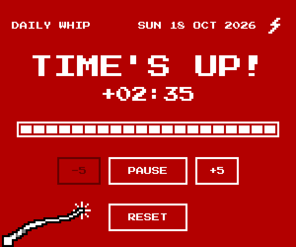

# Daily Whip

> 15 minutes. No excuses.

Un temporizador con estética pixel art para que las dailies terminen a tiempo. Se queda por encima de Meet, Teams o Zoom, se pone en rojo cuando la reunión se acerca al final y, si se pasa, saca el látigo.



Funciona sin conexión, no necesita cuenta y no envía datos a ningún sitio.

## Requisitos

- **Google Chrome o Microsoft Edge** de escritorio, en Windows. También funciona en macOS y Linux.
- Nada más: no hay que instalar herramientas ni registrarse.

## Instalación

1. Abre **https://alexpaz-dev.github.io/dailywhip/** en Chrome o Edge.
2. Instálala como aplicación:
   - **Chrome:** icono de instalar, a la derecha de la barra de direcciones → **Instalar**.
   - **Edge:** menú **⋯** → **Aplicaciones** → **Instalar este sitio como aplicación**.
3. Aparece en el menú Inicio como cualquier otra aplicación y, a partir de ahí, funciona sin conexión.

Sin instalarla también funciona, en una pestaña normal.

## Uso

1. Elige la duración con **-5** y **+5**: de 5 a 30 minutos, 15 por defecto.
2. Pulsa **START**: el temporizador salta a una **ventana flotante**, siempre por encima de las demás. Puedes moverla a donde quieras.
3. **PAUSE** y **RESUME** pausan y reanudan. **RESET** vuelve a la duración que elegiste.
4. **-5** y **+5** también funcionan durante la reunión, como prórroga, sin pasar nunca de 30 minutos. Una daily de más de 30 minutos es una reunión camuflada.
5. **Deja abierta la ventana principal** mientras el temporizador flota; puedes minimizarla. Si la cierras, se cierra el temporizador. **BRING BACK** lo devuelve a ella.

| Fase | Cuándo | Qué pasa |
| :-- | :-- | :-- |
| **NORMAL** | Hasta el 75 % del tiempo | Blanco sobre negro |
| **WARNING** | Desde el 75 % (quedan 03:45 de 15:00) | Fondo rojo parpadeante y aparece el látigo |
| **TIME'S UP** | Al llegar a 00:00 | "TIME'S UP!", el tiempo extra (`+02:35`) y latigazos sin pausa |

**Parpadeo:** el rayo de la cabecera lo enciende o lo apaga, y la app lo recuerda. Si Windows tiene desactivados los efectos de animación, empieza apagado y el látigo aparece quieto.

## Limitaciones

- La ventana flotante solo existe en **Chrome y Edge de escritorio**. En Firefox o Safari el temporizador funciona dentro de la página, sin flotar.
- La ventana flotante lleva la barra de título del navegador y **no se puede minimizar**: se cierra con su X y se vuelve a abrir con **FLOAT**.
- El navegador solo permite **una ventana flotante a la vez**. Si otra web abre la suya, Daily Whip vuelve a la ventana principal; pulsa **FLOAT** para sacarlo de nuevo.

## Privacidad

No hay cuentas, servidor propio ni analítica. GitHub Pages solo sirve los archivos, y la app no envía nada a ningún sitio. Lo único que guarda es la preferencia de parpadeo, en tu navegador.

## Desarrollo

Requisitos: Node 24 y pnpm.

```sh
pnpm install
pnpm dev          # servidor de desarrollo
pnpm test         # tests
pnpm build        # build de producción en dist/
pnpm preview      # sirve la build, con service worker
pnpm screenshots  # capturas de cada fase en screenshots/ (Playwright)
pnpm icons        # regenera los iconos desde su arte en píxeles
```

| Archivo | Qué hace |
| :-- | :-- |
| `src/timer.ts` | Lógica del temporizador: pura, sin DOM, todo se calcula desde el reloj |
| `src/view.ts` | Pinta el temporizador |
| `src/pip.ts` | Ventana flotante (Document Picture-in-Picture) |
| `src/blink.ts` | Preferencia de parpadeo |
| `src/whip.ts` | El látigo: fotogramas en arte ASCII y su sprite |
| `src/sw.js` | Service worker para funcionar sin conexión |
| `scripts/` | Generador de iconos y capturas |

Cada push a `main` pasa los tests y publica en GitHub Pages. El prototipo con el que se validó la idea está en la rama [`prototype`](https://github.com/alexpaz-dev/dailywhip/tree/prototype) y publicado en [`/prototype/`](https://alexpaz-dev.github.io/dailywhip/prototype/). Las decisiones del proyecto están en [DECISIONES.md](DECISIONES.md).

## Licencia

[MIT](LICENSE)
